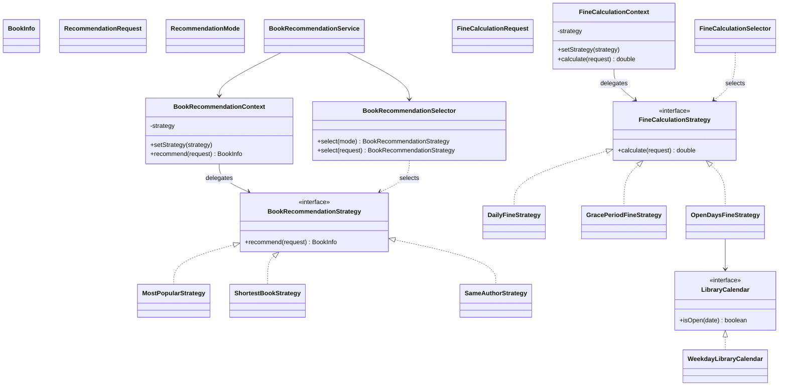

# Library Book Lending System

A Java console application demonstrating the Facade and Strategy design patterns. The lending workflow reserves a book, creates a loan, then confirms the loan.

## Requirements

- Java 17 or newer
- Maven (the included Maven Wrapper can run the project without a separate Maven installation)

## Run the application

From the project folder, run:

```powershell
.\mvnw.cmd clean compile exec:java
```

The program displays a console menu.

## Demo menu

- **1. Complete a normal loan** — runs reservation, lending, and confirmation.
- **2. Demo B failure** — uses an invalid library card. The reservation is cancelled.
- **3. Demo C failure** — simulates confirmation failure. The loan is cancelled first, then the reservation.
- **4. Show saved data** — displays reservations, loans, confirmations, and workflows.
- **5. Recover unfinished workflows** — checks saved workflow states and compensates unfinished work.
- **6. Demo Strategy pattern** — compares all recommendation and fine strategies on the same input, shows automatic selection, and demonstrates runtime strategy replacement.
- **0. Exit** — closes the program.

## Persistence

The application stores data in `data/library.json`. The file is created when the application first saves a record. Workflow progress is saved with statuses such as `PENDING_B`, `PENDING_C`, `COMPLETED`, and `COMPENSATED`.

To reset the demo data:

1. Stop the application.
2. Delete `data/library.json`.
3. Run the application again.

## Tests and coverage

Run all tests with:

```powershell
.\mvnw.cmd test
```

Generate the JaCoCo coverage report with:

```powershell
.\mvnw.cmd clean verify
```

Open `target/site/jacoco/index.html` to view the report.

The tests cover the normal lending workflow, compensation cases, invalid inputs, recovery, each recommendation strategy, each fine strategy, and selector rules. Fine strategy tests inject a fixed calendar through the `LibraryCalendar` interface.

## Main design

- `LibraryMenu` reads user input and calls the facades.
- `LendingFacade` coordinates the reservation, lending, and confirmation services.
- `LibraryAdminFacade` displays saved state and starts recovery.
- Each lending subsystem has its own entity, service, repository, and status enum.
- `JsonFileStore` reads and writes the JSON file.
- `LendingWorkflow` stores progress plus record IDs for the A → B → C chain.

Lending subsystems do not call one another. The facades coordinate them.

## Principle of Least Knowledge

Without the facade, the client needs to know about the separate subsystem services and call them in order:

```java
BookReservation reservation =
        reservationService.reserveBook(bookId, readerId);

BookLoan loan =
        lendingService.createLoan(bookId, readerId, true);

LoanConfirmation confirmation =
        confirmationService.createConfirmation(loan.getId(), 14);

confirmationService.confirm(confirmation.getId());
```

With the facade, the client asks for one complete operation:

```java
lendingFacade.lendBook(bookId, readerId, true, false);
```

The facade knows the sequence and handles compensation. The client does not coordinate the three subsystem services.

## Facade and Adapter

An Adapter changes one interface into another interface that a client already expects. It helps two parts communicate when their interfaces do not match.

This project uses a Facade because the client needs one simple operation that coordinates several separate subsystems. The reservation, lending, and confirmation services do not need their interfaces translated. Instead, `LendingFacade` gives the client one entry point, runs the services in order, saves workflow progress, and compensates earlier work when a later step fails.

## Custom exceptions

- `InvalidLibraryCardException` describes a rejected library card.
- `BookUnavailableException` describes a book that already has an active reservation or loan.

## Strategy Pattern

The application has two independent strategy families. Recommendation strategies select a book from catalog data. Fine strategies calculate a late-return charge. Each context stores one strategy, supports replacement through `setStrategy`, then delegates the operation. Selectors choose strategies from a manual mode or the current request.

### Class responsibilities

Each description below gives one class responsibility in one sentence.

| Class | Responsibility |
|---|---|
| `BookInfo` | Stores one book’s recommendation data. |
| `RecommendationMode` | Names a manually selected recommendation mode. |
| `RecommendationRequest` | Carries catalog data plus reader preferences. |
| `BookRecommendationStrategy` | Defines the common book recommendation operation. |
| `MostPopularStrategy` | Selects the catalog book with the most loans. |
| `ShortestBookStrategy` | Selects the catalog book with the fewest pages. |
| `SameAuthorStrategy` | Selects a catalog book by the preferred author. |
| `BookRecommendationContext` | Stores a recommendation strategy, supports replacement, delegates each request. |
| `BookRecommendationSelector` | Maps a manual mode to a strategy; automatically selects from reader preferences. |
| `BookRecommendationService` | Connects a requested mode to its strategy, then delegates through the context. |
| `FineCalculationRequest` | Carries the due date, return date, daily rate. |
| `FineCalculationStrategy` | Defines the common fine calculation operation. |
| `DailyFineStrategy` | Charges for every overdue calendar day. |
| `GracePeriodFineStrategy` | Waives charges during the first three overdue days. |
| `OpenDaysFineStrategy` | Charges only for overdue days marked open by its calendar. |
| `LibraryCalendar` | Defines whether a date counts as an open library day. |
| `WeekdayLibraryCalendar` | Marks weekdays open, weekends closed. |
| `FineCalculationContext` | Stores a fine strategy, supports replacement, delegates each calculation. |
| `FineCalculationSelector` | Selects a fine strategy from the overdue duration. |

### Class diagram



### Why Strategy

Strategy fits because each family has interchangeable algorithms selected from reader preferences or overdue duration. A context delegates work to its current strategy, which can change at runtime. State models behavior changes caused by an object’s lifecycle state. Template Method keeps one algorithm skeleton in a base class, which does not match these independent alternatives.

### Refactoring commits

- **Before Strategy:** [initial switch implementation](https://github.com/udz4l/library-book-lending-strategy/commit/d807481)
- **After Strategy:** [Strategy implementation with the same recommendation tests](https://github.com/udz4l/library-book-lending-strategy/commit/8973ab0)
